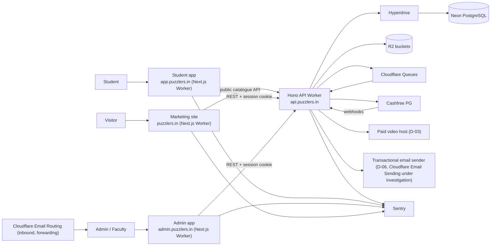
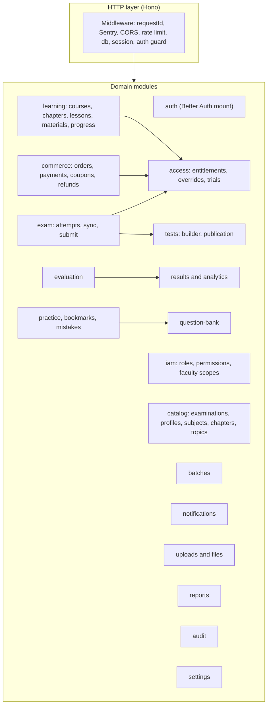
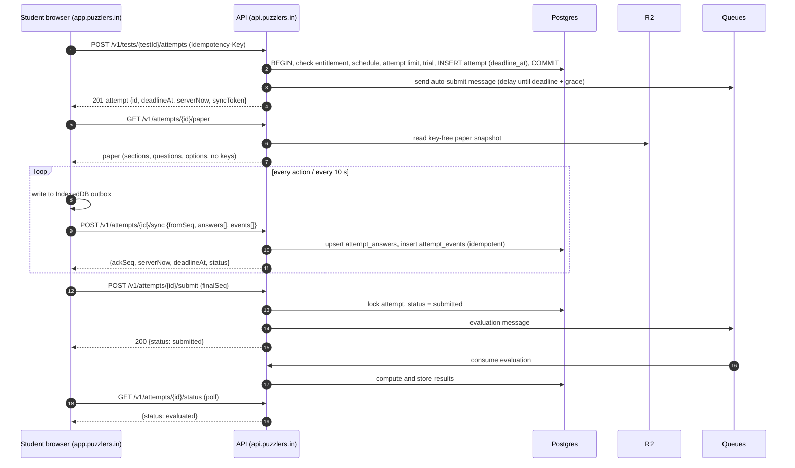
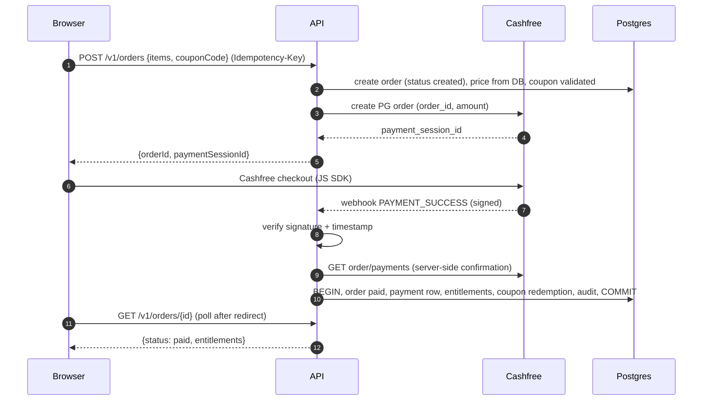
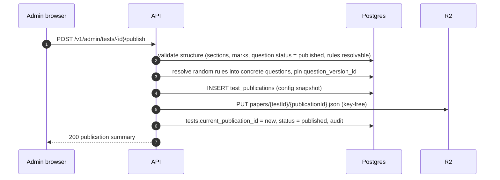

# 05 — System Architecture

## 1. Context

Hostnames are confirmed (D-01 decided): marketing `puzzlers.in`, student `app.puzzlers.in`, admin `admin.puzzlers.in`. The API host `api.puzzlers.in` follows from the same decision, because it must share the registrable domain for cookies.

### 1.1 Backend framework vs runtime (confirmed)

| Concern | Decision |
|---|---|
| Backend framework | **Hono** (TypeScript) |
| Backend runtime and hosting | **Cloudflare Workers**. The Hono app is the Worker's `fetch` handler. The same Worker exports `queue` and `scheduled` handlers. |
| Number of backend applications | **One**: `apps/api`. No second API, no microservices, no backend inside any Next.js app |
| Database access | Drizzle ORM → Hyperdrive binding → Neon PostgreSQL (schema and migrations only in `packages/database`) |
| Explicitly not used | Node.js + Express, NestJS, a traditional Node.js server on a VPS/container, Next.js API routes as the main backend, multiple independent backend services |

Node.js appears in this project only as **development tooling**: pnpm, Turborepo, wrangler, drizzle-kit, Vitest, Playwright and the Next.js build all run on Node.js on developer machines and in CI. Workers' `nodejs_compat` compatibility flag lets libraries such as postgres.js use Node-style APIs **inside the Workers runtime**; it does not mean a Node.js server.

### 1.2 Email

| Need | Service | Status |
|---|---|---|
| Incoming mail to `@puzzlers.in` addresses (support@, admissions@) and forwarding to staff inboxes | **Cloudflare Email Routing** | Decided |
| Transactional outgoing mail to students (email verification, password reset, OTP, payment receipts, notifications) | **Not Email Routing.** Email Routing's Worker send capability only delivers to verified destination addresses, so it cannot reach arbitrary users. Cloudflare Email Sending is being investigated separately. | **Open (D-06)** |

The API calls one `mailer` interface (`apps/api/src/lib/mailer.ts`). Until D-06 is decided, the `console` transport logs messages in local/staging. Production auth flows that need email (verification, reset) are blocked on D-06.

## 2. Deployables

| Deployable | Code | Cloudflare resources | Handlers |
|---|---|---|---|
| `puzzlers-api` | `apps/api` | Hyperdrive binding `HYPERDRIVE`; R2 `R2_PRIVATE`, `R2_PUBLIC`; Queue producers `Q_EVAL`, `Q_JOBS`, `Q_NOTIFY`; Rate-limit bindings; secrets | `fetch` (HTTP), `queue` (consumers), `scheduled` (cron) |
| `puzzlers-student` | `apps/student` | R2 incremental cache (OpenNext); optional service binding `API` | `fetch` |
| `puzzlers-admin` | `apps/admin` | same | `fetch` |
| `puzzlers-marketing` | `apps/marketing` | R2 incremental cache; service binding `API` | `fetch` |

The queue consumers run inside the API Worker (same code, same modules). That keeps the monolith in one place, while the queue still separates request latency from background work. Queue consumers and cron jobs are part of the single API application, not separate backend services.

## 3. API internal module map

Module dependency rule: a module may call another module's **service** functions, never its repo or tables directly. `access` is the only module that answers "can user X use resource Y?".

## 4. Request lifecycle (API)

1. `requestId` middleware assigns `x-request-id` (or accepts a valid incoming one).
2. Sentry wraps the request.
3. CORS: exact-origin allowlist from `ALLOWED_ORIGINS`, `credentials: true`.
4. Rate limiting (Workers rate-limit binding, keyed per IP for anonymous routes and per user for authenticated ones).
5. `db` middleware creates a Drizzle client over the Hyperdrive connection for this request.
6. `session` middleware calls `auth.api.getSession({ headers })` and sets `c.var.user` / `c.var.session` (or null).
7. Route-level guards: `requireAuth()`, `requireRole('admin')`, `requirePermission('question:publish')`, `requireEntitlement(...)`.
8. Zod validation of params, query and body.
9. Service call (transaction where needed) + audit log.
10. Standard response envelope. Errors are mapped by the global `onError`.

## 5. Key flows

### 5.1 Student starts and takes a test

### 5.2 Paid purchase

### 5.3 Admin publishes a test

## 6. Background jobs

| Queue | Message | Producer | Consumer behaviour |
|---|---|---|---|
| `q-eval` | `{type:'evaluate', attemptId}` | submit, auto-submit | Evaluate the attempt; write results; enqueue analytics updates |
| `q-eval` | `{type:'auto_submit', attemptId}` | attempt start (delayed) | If still `in_progress` and the deadline has passed: submit with `source = auto_deadline` |
| `q-jobs` | `{type:'rank_test', testId}` | window close (cron), admin | Compute rank/percentile for all evaluated attempts of the publication |
| `q-jobs` | `{type:'rescore', testId, reason}` | admin (bonus/drop/key change) | Re-evaluate the affected attempts; notify students |
| `q-jobs` | `{type:'report', reportJobId}` | admin | Generate CSV to R2; mark the job done |
| `q-jobs` | `{type:'snapshot', userId}` | after evaluation | Update `performance_snapshots` |
| `q-notify` | `{type:'fanout', notificationId}` | admin broadcast, system events | Insert `user_notifications` in chunks; send email if enabled |

All consumers are **idempotent**: they re-read state and skip work that is already done. Failed messages retry with backoff. After the max retries they go to a dead-letter queue (`q-dlq`) that alerts through Sentry.

### Cron (scheduled handler)

| Schedule | Job |
|---|---|
| every minute | Auto-submit sweep: `in_progress` attempts with `deadline_at + grace < now()` |
| every minute | Enqueue `rank_test` for tests whose window closed in the last minute |
| every 5 minutes | Reconcile `pending` orders older than 10 minutes with Cashfree |
| daily 02:00 IST | Expire entitlements past `ends_at`; clean up expired idempotency keys and unconfirmed uploads |
| daily 03:00 IST | Recompute rank for always-open tests; refresh `question_analytics` |

## 7. Data stores

| Store | Content | Access |
|---|---|---|
| Neon Postgres (primary branch = prod) | All relational data | API only, via Hyperdrive. Migrations via the direct Neon URL from CI. |
| R2 `puzzlers-private` | PDFs, notes, question images (pre-publication), paper snapshots, report exports, invoices | API-issued short-lived URLs only |
| R2 `puzzlers-public` | Marketing images, course thumbnails, published question images | Public via a custom domain (`assets.puzzlers.in`) |
| R2 `opennext-cache-*` | Next.js ISR cache per app | The Next.js Workers |

## 8. Environments

| Env | Hostnames | DB | Purpose |
|---|---|---|---|
| local | `localhost:3000/3001/3002` + `localhost:8787` (or `*.puzzlers.localhost`) | Neon dev branch per developer | Development |
| preview | Workers preview URLs | Neon branch per PR (optional) | PR review |
| staging | `*.staging.puzzlers.in` | Neon `staging` branch | Integration, UAT, load tests |
| production | `*.puzzlers.in` | Neon `main` | Live |

Details: [13-DEPLOYMENT-AND-ENVIRONMENT-SETUP.md](13-DEPLOYMENT-AND-ENVIRONMENT-SETUP.md).

## 9. Scaling posture

- Workers scale horizontally. The bottlenecks are Postgres connections and write throughput.
- Hyperdrive pools connections. Neon compute size (and autoscaling limits) is the main lever. Size it from load-test data, not guesses.
- Exam write path: batched sync (≤ 1 request per ~10 s per student in steady state), single-row upserts keyed by primary key, no analytics on the hot path.
- Read-heavy public catalogue: Next.js ISR + Cache API on the API for `GET /v1/public/*` (60–300 s TTL).
- Paper delivery: from an R2 snapshot, not assembled from joins per student.
- No claims about 2,000 or 10,000 concurrent users until [14 §6](14-TESTING-AND-QUALITY-ASSURANCE.md#6-load-and-performance-testing) load tests pass.
