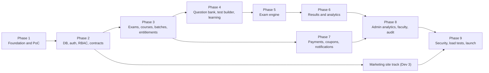

# 16 — Implementation Roadmap

Dependency-based milestones. **No calendar dates are given**, because team availability is unknown. Each phase lists what can run in parallel. Backend tasks follow the module ownership in [15 §1.3](15-TEAM-COORDINATION-AND-INTEGRATION.md#13-module-ownership): Dev 2 the backend foundation and administrative modules plus contract/migration coordination (the steward); Dev 1 the examination-related modules. Dev 3 has no backend tasks. All backend work happens in `apps/api` (Hono on Cloudflare Workers); all schema work in `packages/database`.

PRD phase mapping (C-05): PRD phase 1 = phases 1–2 here; PRD 2 = 3; PRD 3 = 4; PRD 4 = 5; PRD 5 = 6; PRD 6 = 7; PRD 7 = 8; PRD 8 = 9.

---

## Phase 1 — Architecture, monorepo, environments, design tokens, PoC

| Task | Responsible | Depends on |
|---|---|---|
| Name the backup steward and exam-day on-call (D-02b) | Owner | — |
| Create the GitHub repo, monorepo skeleton (pnpm, turbo, config package, lint/format), CI `ci.yml` | Dev 2 | — |
| `@puzzlers/design-tokens` + Tailwind preset + base `@puzzlers/ui` (button, input, card, dialog, toast, badge, skeleton) | Dev 3 (with Dev 1, Dev 2 review) | skeleton |
| Cloudflare account setup (zone, R2, Queues, Hyperdrive), Neon project + branches, Sentry | Dev 2 / owner | DNS for `puzzlers.in` |
| **PoC P-1…P-10** ([04 §5](04-TECHNOLOGY-STACK-AND-ENGINEERING-RULES.md#5-mandatory-proof-of-concept-phase-1-gate)) | P-1 marketing: Dev 3. P-1/P-4/P-10 student: Dev 1. P-1 admin + P-5 R2 upload: Dev 2. P-2/P-3/P-6/P-7/P-8: Dev 2 (API owner for the PoC), with Dev 1 on P-4/P-10 | accounts |
| App shells: marketing layout, student layout (sidebar/bottom nav), admin layout (sidebar, permission nav placeholder) | Dev 3 / Dev 1 / Dev 2 | tokens |

**Deliverables:** the repo with 4 deployables deployed to staging; the PoC report (pass/fail per check, workarounds); the token package.
**Acceptance:** every PoC check passes or has an approved workaround in [17](17-OPEN-DECISIONS-AND-ASSUMPTIONS.md). `pnpm lint typecheck test build` is green. All three shells render on staging with shared tokens.
**Blockers:** Cloudflare/Neon account access.
**Integration checkpoint IC-1:** log in on the student shell (stub user) → the admin shell sees the session (P-4).

## Phase 2 — Database foundation, auth, roles, permissions, API contracts

| Task | Responsible | Depends on |
|---|---|---|
| `@puzzlers/database`: identity, taxonomy and settings tables; migration pipeline; `seed:system`, `seed:taxonomy` | Dev 2 | P-3 |
| `@puzzlers/schemas`: envelope, errors, enums, permissions, auth/me schemas, **full contract skeleton for Phases 3–7** (schemas may be stubs, names fixed) | Dev 2 with all devs | — |
| Better Auth integration, `/auth/*`, `/v1/me`, onboarding | Dev 2 | database |
| RBAC: roles/permissions seed, guards, faculty scope middleware | Dev 2 | auth |
| `@puzzlers/api-client` (server + browser modes, error mapping) | Dev 2 | schemas |
| Student: register, login, logout, forgot/reset, onboarding, profile, sessions | Dev 1 | auth |
| Admin: login, permission-based navigation, staff list, roles screen | Dev 2 | RBAC |
| Marketing: header auth state, login/register entry links | Dev 3 | `/v1/me` |
| Audit log writer + middleware helpers | Dev 2 | database |
| Mock handlers for all Phase 3–6 endpoints | each endpoint owner | schemas |

**Deliverables:** working auth across apps on staging; the RBAC seed; the contract skeleton merged.
**Acceptance:** J-01 up to the dashboard shell; the admin permission nav hides modules correctly per role; route-guard coverage test in place.
**Blockers:** D-06 transactional email sender (Cloudflare Email Routing cannot send verification/reset mail; use the console transport until D-06 closes); D-09 login methods.
**IC-2:** all three apps show the correct logged-in state. A suspended test user is logged out.

## Phase 3 — Examinations, courses, batches, entitlements

| Task | Responsible | Depends on |
|---|---|---|
| Exam/profile/taxonomy CRUD API + admin screens | Dev 2 | Phase 2 |
| Course/chapter/topic/lesson tables + admin CRUD + reorder; uploads (R2 presign/confirm) | Dev 2 | Phase 2 |
| Batch tables + admin CRUD + course/test assignment (tests as placeholders until Phase 4) | Dev 2 | courses |
| `access.canAccess`, entitlements, overrides, trials + admin access screens | Dev 2 (API + UI; Dev 1 reviews) | batches |
| Free enrollment (batch/course) | Dev 2 (API, B-08), Dev 1 (UI) | access |
| Student My Batches, My Courses, course tree with lock states | Dev 1 | access |
| Public catalogue endpoints (B-18) | Dev 2 | courses, batches |
| Marketing courses/batches/test-series listing + detail pages (consuming the public API) | Dev 3 | public endpoints (mocks first) |

**Deliverables:** an admin can create a full course and a free/paid batch; a student can enroll in a free batch and see the courses; the marketing catalogue is live with real data.
**Acceptance:** PRD MVP AC-1…AC-5, AC-8, AC-9 (see [18](18-ACCEPTANCE-CRITERIA.md)); the access decision-table tests pass.
**Blockers:** D-07 for real exam configurations (placeholders are acceptable).
**IC-3:** admin publishes a batch → marketing lists it within the ISR window → student enrolls → admin sees the enrollment.

## Phase 4 — Question bank, test builder, learning content, student learning experience

| Task | Responsible | Depends on |
|---|---|---|
| Question tables, versions, options, review workflow, import (dry-run report) | Dev 2 | Phase 3 taxonomy |
| Question editor (Tiptap + KaTeX), preview, images | Dev 2 | uploads |
| `exam-core` package: types, palette reducer, scoring, numeric normalisation (+ full tests) | Dev 1 | schemas |
| Test builder: sections, manual + rule selection, validation, preview, **publication + paper snapshot** | Dev 2 (UI + API) with Dev 1 review | questions, exam-core |
| Student course/lesson read endpoints, progress, playback/file URLs (B-07) | Dev 2 | Phase 3 |
| Student lesson player: video (YouTube + paid host adapter stub), PDF viewer, notes, materials, progress (UI) | Dev 1 | B-07 |
| Practice sessions, bookmarks, notebooks | Dev 1 | questions |
| Paid video host integration (signed playback in `learning`) | Dev 2 (API), Dev 1 (player) | **D-03** |

**Deliverables:** a published 3-section test with all question types; a student can study lessons and practise.
**Acceptance:** AC-10, AC-11; J-02, J-07; exam-core coverage at 100 %.
**Blockers:** D-03 (paid video; YouTube-only and free lessons are possible meanwhile); D-20 (import format).
**IC-4:** admin publishes a test → paper JSON in R2 contains no keys (contract test) → the student sees the test card in the correct state.

## Phase 5 — Examination engine: autosave, recovery, submission, evaluation

| Task | Responsible | Depends on |
|---|---|---|
| Attempt API: start/resume, paper, state, sync, beacon, submit, status | Dev 1 | Phase 4 |
| Auto-submit: delayed queue + cron sweep | Dev 1 | attempts |
| Evaluation consumer + results tables | Dev 1 | exam-core |
| Exam UI: instructions, layout, palette, question renderers (all types, passages), section tabs, timer, save pill, offline banner, submit summary, time-over flow | Dev 1 | paper |
| IndexedDB outbox, recovery, multi-tab leadership | Dev 1 | sync |
| Admin live-exam monitor + force-submit/invalidate (screens) | Dev 2 | Dev 1 admin exam-ops endpoints |

**Deliverables:** a complete CBT attempt end to end on staging.
**Acceptance:** AC-12, AC-13, AC-14; EX-01…EX-20; J-04, J-05, J-06; LT-1 (500 VUs) passes early as a smoke load test.
**Blockers:** none beyond Phase 4. D-10 (suspend policy) and D-11 (palette defaults) must be confirmed before a pilot.
**IC-5:** 20-person internal mock test on staging with deliberate network drops; zero lost answers.

## Phase 6 — Results, analytics, dashboard, learning progress

| Task | Responsible | Depends on |
|---|---|---|
| Result + analysis endpoints (overview, sections/subjects, chapters, difficulty, time, question grid, solutions with release rules) | Dev 1 | Phase 5 |
| Rank/percentile job, leaderboard, opt-out | Dev 1 | results |
| Performance snapshots, weak areas, historical comparison | Dev 1 | results |
| My Mistakes | Dev 1 | results + practice |
| Student dashboard aggregate endpoint + page | Dev 1 | most of the above |
| Notifications inbox (student) | Dev 1 | B-21 skeleton |
| Admin: results release/rescore/bonus/drop screens | Dev 2 | evaluation |

**Deliverables:** students see full analytics; admins can release and rescore.
**Acceptance:** AC-15 (analytics); EX-15…EX-17; J-04 complete through solutions.
**IC-6:** rescore a test with a bonus question → student scores and ranks update and a notification arrives.

## Phase 7 — Cashfree, payments, orders, coupons, notifications

*Can start after Phase 3 in parallel with Phases 4–6 if staffing allows.*

| Task | Responsible | Depends on |
|---|---|---|
| Orders, Cashfree order creation, checkout integration, return page | Dev 2 (API), Dev 1 (UI) | Phase 3 access |
| Webhooks, verification, fulfilment, reconciliation cron | Dev 2 | orders |
| Refunds (API + admin UI) | Dev 2 | payments |
| Coupons (API + admin UI) + apply at checkout | Dev 2 / Dev 1 | orders |
| Notifications: admin compose/schedule, fan-out, system triggers, email (once D-06 picks a sender) | Dev 2 | Phase 2 |
| Purchase history (student), orders/payments screens (admin) | Dev 1 / Dev 2 | orders |
| Marketing pricing page with live prices + buy CTAs | Dev 3 | catalogue |

**Deliverables:** paid batch/course purchase in the sandbox; coupons; refunds; notifications.
**Acceptance:** AC-6, AC-7, AC-16 (Cashfree verified server-side); commerce test suite; J-03, J-11.
**Blockers:** D-05 (coupon/refund policy), D-06 (email), D-17 (GST/invoices), Cashfree sandbox access.
**IC-7:** purchase → webhook delivered twice + manual reconcile → exactly one entitlement, one payment row, one coupon redemption.

## Phase 8 — Admin analytics, faculty, audit logs, advanced operations

| Task | Responsible | Depends on |
|---|---|---|
| Admin dashboard metrics endpoint + page | Dev 2 | Phases 6–7 |
| Analytics pages (revenue, enrollments, tests, courses), report exports via queue | Dev 2 | |
| Faculty management, assignments, scoped views, activity | Dev 2 | RBAC |
| Audit log viewer, entity history panels | Dev 2 | audit writer |
| Bulk operations (grant access, import students *[Rec]*, export) | Dev 2 | |
| Settings screens (trial count, grace, maintenance, FAQs content) | Dev 2 | |
| Marketing: FAQs from the API, exam landing pages finished, legal pages, SEO completion | Dev 3 | |

**Deliverables:** complete admin operations.
**Acceptance:** AC-17, AC-18; the permission-matrix test suite passes; J-08, J-09, J-10.
**IC-8:** a faculty user can only see and edit assigned resources; every sensitive action appears in the audit log.

## Phase 9 — Security testing, performance testing, load testing, launch

| Task | Responsible |
|---|---|
| Security test suites (IDOR, permissions, uploads, XSS, CSRF, rate limits), CSP enforce, headers | All (Dev 2 coordinates) |
| Optional external penetration test *[Rec]* | Owner |
| Load tests LT-1…LT-7 + catalogue LT-C1…C3; fixes; re-runs | Dev 1 + Dev 2 |
| Accessibility audits per app | Each developer |
| Backup restore drill; runbook; on-call; alerts | Dev 2 |
| Launch checklist ([12 §18](12-SECURITY-AND-PRODUCTION-READINESS.md#18-production-launch-checklist)) | All; owner signs off |
| Pilot mock exam with real students (≥ 50) | Owner + all |

**Deliverables:** load-test reports, a security report, a signed launch checklist.
**Acceptance:** AC-19; LT-3 at 2,000 passes.
**Blockers:** D-08 (load targets, exam-day checklist), D-18 (legal).
**IC-9:** the production smoke test passes; a pilot mock completes with zero lost answers.

---

## Parallel work summary

| Phase | Dev 1 (student app + exam backend modules) | Dev 2 (admin app + backend foundation + admin modules + steward) | Dev 3 (marketing website, no backend) |
|---|---|---|---|
| 1 | Student shell, auth/SSR PoC (P-4, P-10) | Admin shell, Hono-on-Workers API PoC, R2 PoC, CI | Tokens/UI base, marketing PoC, layout |
| 2 | Auth screens, profile | DB package, Better Auth, RBAC, contract skeleton, admin auth/nav | Header auth state; static pages (home skeleton, about, legal drafts) |
| 3 | My Batches/Courses, enroll UI | Exams, courses, batches, enrollment, access, public endpoints (API + UI) | Catalogue pages consuming the public API |
| 4 | exam-core, lesson UI, practice (UI + API) | Question bank, test builder + publication (API + UI) | Exam landing pages, features, FAQ |
| 5 | **Exam engine** (client + server) | Live monitor | SEO, structured data, performance |
| 6 | Results, analytics, dashboard | Results admin | Pricing (after Phase 7 API) |
| 7 | Checkout UI | Orders/Cashfree/webhooks, coupons, refunds, notifications (API + UI) | Pricing page live, CTAs |
| 8 | Polish, notifications inbox | Dashboard, analytics, faculty, audit | Content completion, a11y |
| 9 | Load tests, exam a11y | Admin a11y, security tests | Lighthouse/SEO audit |

Developer 3 has spare capacity in Phases 4–6. Recommended use: own `@puzzlers/ui` quality, Storybook-style component docs *[Rec]*, and help with admin tables/forms components.
